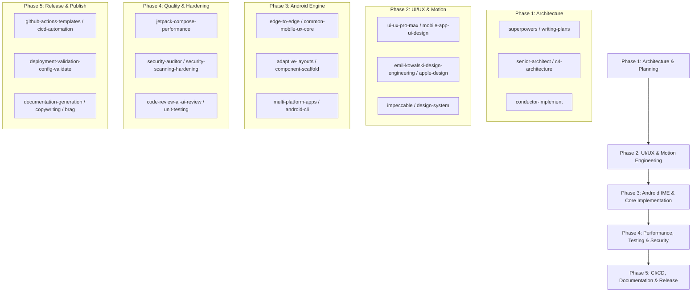

# Mobile Keyboard & App Engineering Suite

This master skill acts as the unified index, reference catalog, and runbook orchestrating all installed skills across UI/UX, native Android development, system architecture, performance optimization, security hardening, and publishing.

---

## 1. Installed Skills Directory by Domain

### Domain 1: UI/UX, Design Systems & Motion
- [`ui-ux-pro-max`](file:///home/bheeshamks/.agents/skills/ui-ux-pro-max/SKILL.md): 50+ design styles, dark mode color token rules, glassmorphism, depth hierarchies, and micro-interaction principles.
- [`mobile-app-ui-design`](file:///home/bheeshamks/.agents/skills/mobile-app-ui-design/SKILL.md): 8-point grid enforcement, 60/30/10 color rule, thumb-zone ergonomics, tactile feedback loops, and mobile navigation layouts.
- [`common-mobile-ux-core`](file:///home/bheeshamks/.agents/skills/common-mobile-ux-core/SKILL.md): Android-specific 48dp minimum touch targets, WindowInsets / safe-area handling, active/pressed states (no desktop hover patterns), and haptic rules.
- [`emil-kowalski-design-engineering`](file:///home/bheeshamks/.agents/skills/emil-design-eng/SKILL.md): Purposeful UI motion, spring physics, gesture-driven interactivity, and interruptible animations (e.g. Samsung Keys Cafe radial ripple effects).
- [`apple-design`](file:///home/bheeshamks/.agents/skills/apple-design/SKILL.md): Human Interface Guidelines (HIG), spatial layout, tactile interaction standards, and fluid transitions.
- [`impeccable`](file:///home/bheeshamks/.agents/skills/impeccable/SKILL.md): Anti-slop design guardian enforcing typography precision, color harmony, visual restraint, and custom layout craftsmanship.
- [`frontend-design`](file:///home/bheeshamks/.agents/skills/frontend-design/SKILL.md): High-fidelity frontend design patterns, avoiding generic AI layouts, custom canvas shaders, and draw modifiers.
- [`ui-design-system`](file:///home/bheeshamks/.agents/skills/design-system/SKILL.md): Cohesive design token generation, typography scale, surface elevation, and reusable component systems.

### Domain 2: Native Android & Mobile Development
- [`edge-to-edge`](file:///home/bheeshamks/.agents/skills/edge-to-edge/SKILL.md): Android 15+ edge-to-edge enforcement, WindowInsetsCompat, IME keyboard inset handling, and system bar legibility.
- [`adaptive-layouts`](file:///home/bheeshamks/.agents/skills/adaptive/SKILL.md): Responsive UI scaling across phones, foldables, tablets, and split-screen keyboard modes.
- [`r8-optimization`](file:///home/bheeshamks/.agents/skills/r8-analyzer/SKILL.md): R8/ProGuard rules configuration for Retrofit, OkHttp, Kotlinx Serialization, and Coroutines to ensure release APKs don't crash.
- [`accessibility-a11y`](file:///home/bheeshamks/.agents/skills/accessibility-a11y/SKILL.md): WCAG & Android accessibility audits, AccessibilityService node traversal, talkback labels, and overlay compliance.
- [`frontend-mobile-development-component-scaffold`](file:///home/bheeshamks/.agents/skills/frontend-mobile-development-component-scaffold/SKILL.md): Modular, reusable Jetpack Compose components with clean state hoisting and unidirectional data flow.
- [`multi-platform-apps`](file:///home/bheeshamks/.agents/skills/multi-platform-apps-multi-platform/SKILL.md): Architecture decoupling shared core engines (Audio recording + Groq API) from Android system UI and InputMethodService entry points.
- [`android-cli`](file:///home/bheeshamks/.agents/skills/android-cli/SKILL.md): Official Google Android CLI tool (`~/.local/bin/android`) for project scaffolding, emulator automation, UI inspection, and SDK management.

### Domain 3: Architecture, Planning & Engineering Discipline
- [`superpowers`](file:///home/bheeshamks/.agents/skills/using-superpowers/SKILL.md): Disciplined execution workflow requiring structured planning ([`writing-plans`](file:///home/bheeshamks/.agents/skills/writing-plans/SKILL.md)), modular implementation ([`executing-plans`](file:///home/bheeshamks/.agents/skills/executing-plans/SKILL.md)), and pre-completion verification ([`verification-before-completion`](file:///home/bheeshamks/.agents/skills/verification-before-completion/SKILL.md)) to prevent stubbing and // TODO shortcuts.
- [`senior-architect`](file:///home/bheeshamks/.agents/skills/senior-architect/SKILL.md): High-level system architecture, component contracts, error boundaries, and reactive streaming pipelines.
- [`c4-architecture`](file:///home/bheeshamks/.agents/skills/c4-architecture-c4-architecture/SKILL.md): C4 model diagrams (Context, Container, Component, Code) for recording audio $\rightarrow$ Groq Whisper API $\rightarrow$ IME text injection pipeline.
- [`conductor-implement`](file:///home/bheeshamks/.agents/skills/conductor-implement/SKILL.md): Structured multi-track implementation keeping large code generation tasks synchronized.
- [`context-driven-development`](file:///home/bheeshamks/.agents/skills/context-driven-development/SKILL.md): Context preservation across complex multi-file modules and state trees.
- [`ponytail`](file:///home/bheeshamks/.agents/skills/ponytail/SKILL.md): Pragmatic coding discipline—tracing real data flow, enforcing strict type boundaries, and rejecting unnecessary boilerplate.

### Domain 4: Performance, Testing & Security
- [`application-performance-optimization`](file:///home/bheeshamks/.agents/skills/application-performance-performance-optimization/SKILL.md) & [`jetpack-compose-performance`](file:///home/bheeshamks/.agents/skills/jetpack-compose-performance/SKILL.md): Enforces `@Stable`, `@Immutable`, `remember`, `derivedStateOf`, and `drawBehind` modifiers in Jetpack Compose to maintain sub-16ms (60/120fps) key-press latency and 0% idle CPU.
- [`security-auditor`](file:///home/bheeshamks/.agents/skills/security-auditor/SKILL.md): Audits IPC boundaries, Android Keystore integration, encrypted data stores, and permission scopes.
- [`security-scanning-hardening`](file:///home/bheeshamks/.agents/skills/security-scanning-security-hardening/SKILL.md): Enforces EncryptedSharedPreferences with hardware-backed master keys for Groq API keys, and `FLAG_SECURE` window detection to auto-disable the IME overlay on banking/password screens.
- [`code-review-ai-ai-review`](file:///home/bheeshamks/.agents/skills/code-review-ai-ai-review/SKILL.md): Rigorous static analysis verifying WAV audio buffer cleanup, non-blocking I/O, and coroutine lifecycle cancellation.
- [`unit-testing-test-generate`](file:///home/bheeshamks/.agents/skills/unit-testing-test-generate/SKILL.md): Automated unit test generation for state machines, audio encoders, and Groq API client handlers.

### Domain 5: Publisher, CI/CD & Release Management
- [`cicd-automation-workflow-automate`](file:///home/bheeshamks/.agents/skills/cicd-automation-workflow-automate/SKILL.md): End-to-end CI/CD automation pipeline design.
- [`github-actions-templates`](file:///home/bheeshamks/.agents/skills/github-actions-templates/SKILL.md): Production `.github/workflows/release.yml` template to compile, lint, run tests, sign release APK/AAB, and attach release assets.
- [`deployment-validation-config-validate`](file:///home/bheeshamks/.agents/skills/deployment-validation-config-validate/SKILL.md): Automated validation of Gradle signing configs, keystore environment secrets, semantic versioning, and AndroidManifest permissions.
- [`documentation-generation-doc-generate`](file:///home/bheeshamks/.agents/skills/documentation-generation-doc-generate/SKILL.md): Generates README.md, Google Play accessibility disclosures, onboarding permissions guide, and privacy policies.
- [`copywriting`](file:///home/bheeshamks/.agents/skills/copywriting/SKILL.md): High-converting copy for onboarding flows, settings descriptions, and store listings.
- [`brag`](file:///home/bheeshamks/.agents/skills/brag/SKILL.md): Launch announcements, showcase copy, demo scripts, and release highlight documents.

---

## 2. Standard Development Pipeline Workflow

When implementing features in FreeFlow Pocket (e.g. voice-to-text floating keyboard overlay):

---

## 3. Quick Reference for Triggering Skills

- **To plan a new feature**: Activate `superpowers` + `senior-architect`.
- **To style keyboard UI & floating bar**: Activate `ui-ux-pro-max` + `mobile-app-ui-design`.
- **To add Keys Cafe style key-press animations**: Activate `emil-kowalski-design-engineering`.
- **To fix keyboard overlapping system bars / navigation**: Activate `edge-to-edge`.
- **To eliminate Compose recomposition lag / stutter**: Activate `application-performance-optimization` + `jetpack-compose-performance`.
- **To secure Groq API keys & protect against banking apps**: Activate `security-scanning-hardening` + `security-auditor`.
- **To configure automated release builds**: Activate `github-actions-templates` + `deployment-validation-config-validate`.
- **To generate launch materials and disclosures**: Activate `documentation-generation-doc-generate` + `copywriting` + `brag`.
