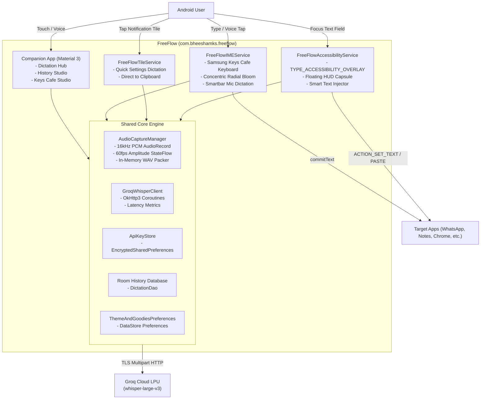

# FreeFlow for Android (FreeFlow Pocket)

<p align="center">
  
</p>

<p align="center">
  <b>Ultra-fast (~300ms), private voice dictation for Android powered by Groq LPU Whisper.</b><br>
  <i>Wispr Flow-style floating bubble, Quick Settings tile, and a Samsung Good Lock Keys Cafe inspired custom keyboard.</i>
</p>

<p align="center">
  <a href="https://github.com/BheeshamKS/FreeFlow-Pocket/actions"></a>
  <a href="https://github.com/BheeshamKS/FreeFlow-Pocket/releases"></a>
  
  
  
</p>

---

## ⚡ Highlights & Key Features

- **⚡ Sub-Second Dictation (~300ms)**: Direct streaming to Groq Cloud LPUs (`whisper-large-v3`) via OkHttp3 with zero temporary files written to flash storage.
- **🫧 Wispr Flow Floating Capsule**: Mounts an accessibility overlay over any focused editable text box with real-time reactive audio waveform bars. Supports both **Hold-to-Talk** and **Tap-to-Toggle**. Features persistent drag-and-dock memory restoring exact screen edge and vertical positioning.
- **🛡️ Automatic Banking & Password Bypass**: Immediately suppresses and dismisses overlays on password fields (`isPassword == true`), secure windows (`FLAG_SECURE`), or user-defined excluded applications.
- **✨ Side Goodies (Samsung Keys Cafe Custom IME)**:
  - Custom `InputMethodService` built in 100% Jetpack Compose.
  - Seamless AMOLED black (`#0D0D11`) and theme-matched solid navigation bar, completely eliminating see-through background gaps.
  - Dual-State Smartbar: Utility toolbar with Clipboard history, Samsung-style emoji categories with live search, Case inversion, and 3 live dynamic word suggestions on typing.
  - **Universal Swipe-Down Gesture**: Natural swipe-down gesture across the smartbar, keycaps, and menus to dismiss the keyboard immediately.
  - **Concentric Radial Bloom Touch Shaders**: Hardware-accelerated canvas draw calls (`Modifier.drawWithCache`) render Good Lock Keys Cafe radial bloom ripples with sub-16ms latency without recomposing the keycap grid.
  - Integrated Smartbar FreeFlow Mic: Dims the keyboard and renders an audio-reactive glowing orb during voice dictation.
  - Spacebar horizontal swipe trackpad cursor movement and accelerated backspace.
- **🥷 Ninja Mode Quick Settings Tile**: Dictate directly from Android's notification shade; transcribed speech is copied instantly to your system Clipboard with tactile haptic confirmation.
- **💾 Keep Data on Uninstall & Seamless Updates**:
  - `android:hasFragileUserData="true"`: Android OS prompts with a "Keep app data" checkbox when uninstalling, preserving all themes, API keys, bubble coordinates, and dictations on reinstall.
  - Auto-Backup & Data Extraction Rules: Cloud and device-to-device migration support for preferences and local databases.
  - Settings Backup & Restore: Built-in 1-tap JSON export and import for user settings in the Settings Studio.
  - Unified Repository Keystore: Ensures cross-version update compatibility without signature mismatch.
- **🔒 Zero-Keylogger & Hardware-Backed Security**: User Groq API keys are stored in `EncryptedSharedPreferences` backed by the Android Keystore.
- **📁 100% Local Dictation History**: Searchable SQLite database via Room with word counters and latency metrics.

---

## 🏛️ System Architecture



---

## 📋 Google Play & F-Droid Prominent Disclosure

> **Accessibility Service API Usage**
> FreeFlow uses the Android `AccessibilityService` API exclusively to detect when an editable text box gains input focus, allowing the app to display the floating voice capsule HUD and paste the transcribed text directly at your cursor position via `ACTION_SET_TEXT` or clipboard paste.
>
> - **No Keystroke Logging**: FreeFlow does NOT collect, read, transmit, or monitor typed keystrokes.
> - **No Password Capture**: Password fields (`isPassword == true`) and `FLAG_SECURE` banking screens automatically suppress and destroy the floating overlay.
> - **In-Memory Audio**: Audio is captured into a RAM buffer and erased immediately once the Groq API returns transcription.

---

## 🚀 Building & Publishing

### Prerequisites
- JDK 17
- Android SDK with API Level 35 (Android 15)
- Gradle 8.11+

### Build Commands
```bash
# Run Unit Tests
./gradlew test

# Build Debug APK
./gradlew assembleDebug

# Build Release APK and AAB Bundle
./gradlew assembleRelease bundleRelease
```

### Pre-built Production APK
A production release build is available at [`build_outputs/FreeFlow-Pocket.apk`](build_outputs/FreeFlow-Pocket.apk) (Version 1.0.2, Build 3), signed with APK Signature Scheme v2.

---

## 📄 License

FreeFlow is licensed under the [MIT License](LICENSE).
