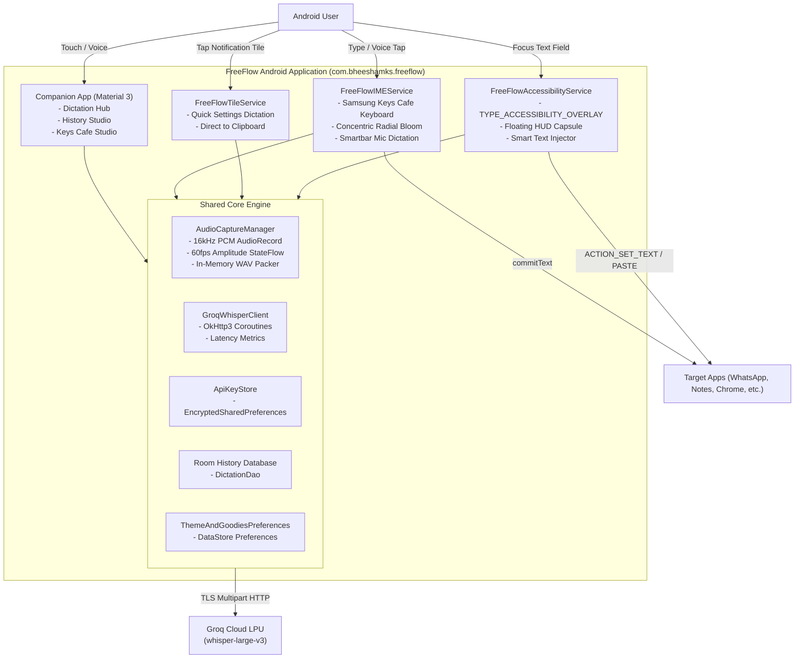
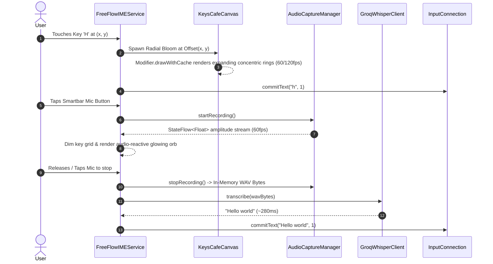

# FreeFlow Android (FreeFlow Pocket) Implementation Plan

> **For agentic workers:** REQUIRED SUB-SKILL: Use `superpowers:subagent-driven-development` (recommended) or `superpowers:executing-plans` to implement this plan task-by-task. Steps use checkbox (`- [ ]`) syntax for tracking.

**Goal:** Build a zero-stub, production-ready native Android application (`com.bheeshamks.freeflow`) in 100% Kotlin and Jetpack Compose featuring ultra-fast (~300ms) voice dictation via Groq Whisper LPU, a Wispr Flow-style Accessibility floating capsule, a Quick Settings Tile, a Samsung Good Lock / Keys Cafe custom IME keyboard with glowing radial bloom animations, an uncluttered Material 3 companion app, and automated GitHub Actions CI/CD release publishing.

**Architecture:** Unidirectional Data Flow (MVI/MVVM) decoupling low-level system services (`AccessibilityService`, `InputMethodService`, `TileService`) from a reactive Core Audio/Groq engine. Persistence is partitioned between hardware-backed `EncryptedSharedPreferences` for API keys, Room DB for local dictation history, and Jetpack DataStore for UI/keyboard preferences. Touch shaders in the custom keyboard utilize `Modifier.drawWithCache` to render concentric radial bloom graphics with sub-16ms latency without triggering Compose recomposition cascades.

**Tech Stack:**
- **Language & Runtime:** Kotlin 2.1.0, Android Gradle Plugin 8.8.0, Target SDK 35 (Android 15), Min SDK 26 (Android 8.0)
- **UI Framework:** Jetpack Compose (BOM 2025.02.00), Material 3, Foundation, Navigation Compose
- **Concurrency & Streams:** Kotlin Coroutines 1.10.1, StateFlow/SharedFlow
- **Networking:** OkHttp 4.12.0 (multipart audio streaming to Groq Whisper API)
- **Audio Capture:** Android `AudioRecord` (16kHz, 16-bit mono PCM) with in-memory 44-byte RIFF/WAV packaging
- **Security & Storage:** AndroidX Security Crypto 1.1.0-alpha06 (`EncryptedSharedPreferences`), Room 2.6.1 with KSP, Jetpack DataStore Preferences 1.1.2
- **Testing:** JUnit 4, Kotlinx Coroutines Test, MockWebServer, AndroidX Test Core/Runner

**Spec:** Referenced from user prompt and desktop reference architecture at `/mnt/SSD_Storage/Coding/FreeFlow`.

---

## Global Constraints

- **Package Name:** `com.bheeshamks.freeflow`
- **Zero Stub Policy:** No `// TODO`, no mock stubs, no truncated placeholders. Every file must be complete, idiomatic Kotlin/XML.
- **Memory & Disk I/O:** Audio capture must remain strictly in memory (byte array buffer) with a 44-byte RIFF/WAVE header—zero temporary audio files written to flash storage.
- **Privacy & Security:** Hardware-backed MasterKey encryption for Groq API keys; automatic suppression and teardown of Accessibility floating HUD on password fields (`node.isPassword == true`), secure windows (`FLAG_SECURE`), and user-excluded package names.
- **Rendering Performance:** Samsung Keys Cafe bloom animations must run via hardware-accelerated canvas draw calls (`Modifier.drawWithCache` / `drawBehind`) without triggering layout or recomposition of individual keycap composables.
- **Edge-to-Edge:** Full Android 15 edge-to-edge support with `WindowInsetsCompat` and safe-area padding across all views.

---

## Review Focus

1. **Audio Record Buffer Underrun / Memory Leak:** Continuous recording at 16kHz mono generates 32,000 bytes/sec. The coroutine collector must drain the `AudioRecord` buffer synchronously into a pre-allocated or expandable memory stream and release the native recorder on cancellation.
2. **Accessibility Overlay Crash on Android 14+:** Adding `TYPE_ACCESSIBILITY_OVERLAY` to `WindowManager` without proper window token or before service lifecycle initialization throws `BadTokenException`. Overlay lifecycle must hook into `onServiceConnected` and manage window removal cleanly.
3. **Compose inside InputMethodService Lifecycle Tree:** Jetpack Compose requires `ViewTreeLifecycleOwner`, `ViewTreeViewModelStoreOwner`, and `ViewTreeSavedStateRegistryOwner` on the root view. Without a custom bridge, Compose throws `IllegalStateException`.
4. **Groq Whisper Multipart Request Format:** Groq's `/openai/v1/audio/transcriptions` requires a proper multipart payload with `filename="audio.wav"`, `Content-Type: audio/wav`, model parameter (`whisper-large-v3`), and Bearer auth. Empty or malformed headers will reject with 400/401.
5. **Smart Text Injection Cursor Splicing:** On standard `EditText` fields, `AccessibilityNodeInfo.performAction(ACTION_SET_TEXT)` replaces the entire text unless existing text is retrieved, cursor slice is calculated, and new text is spliced in. Fallback to `ClipboardManager` + `ACTION_PASTE` must trigger if `ACTION_SET_TEXT` fails or returns false (e.g. Chrome/WebViews).

---

## System Architecture Diagrams

### 1. C4 Container Diagram


### 2. Live Dictation & Keys Cafe Bloom Pipeline


---

## File Tree Structure

```
FreeFlow-Pocket/
├── .github/
│   └── workflows/
│       └── android-release.yml
├── app/
│   ├── build.gradle.kts
│   ├── proguard-rules.pro
│   └── src/
│       ├── main/
│       │   ├── AndroidManifest.xml
│       │   ├── java/com/bheeshamks/freeflow/
│       │   │   ├── FreeFlowApplication.kt
│       │   │   ├── core/
│       │   │   │   ├── audio/
│       │   │   │   │   ├── AudioCaptureManager.kt
│       │   │   │   │   └── WavEncoder.kt
│       │   │   │   ├── data/
│       │   │   │   │   ├── db/
│       │   │   │   │   │   ├── DictationDao.kt
│       │   │   │   │   │   ├── DictationEntity.kt
│       │   │   │   │   │   └── HistoryDatabase.kt
│       │   │   │   │   ├── model/
│       │   │   │   │   │   └── KeyboardSettings.kt
│       │   │   │   │   └── prefs/
│       │   │   │   │       └── ThemeAndGoodiesPreferences.kt
│       │   │   │   ├── network/
│       │   │   │   │   ├── GroqModels.kt
│       │   │   │   │   └── GroqWhisperClient.kt
│       │   │   │   └── security/
│       │   │   │       └── ApiKeyStore.kt
│       │   │   ├── ime/
│       │   │   │   ├── FreeFlowIMEService.kt
│       │   │   │   ├── KeysCafeCanvas.kt
│       │   │   │   ├── lifecycle/
│       │   │   │   │   └── ImeComposeView.kt
│       │   │   │   ├── model/
│       │   │   │   │   └── KeyModel.kt
│       │   │   │   └── ui/
│       │   │   │       ├── Keycap.kt
│       │   │   │       ├── KeyboardLayout.kt
│       │   │   │       ├── KeyboardScreen.kt
│       │   │   │       ├── KeyboardVoiceHUD.kt
│       │   │   │       └── Smartbar.kt
│       │   │   ├── service/
│       │   │   │   ├── FreeFlowAccessibilityService.kt
│       │   │   │   ├── FreeFlowTileService.kt
│       │   │   │   ├── overlay/
│       │   │   │   │   ├── FloatingOverlayManager.kt
│       │   │   │   │   └── FloatingWaveformHUD.kt
│       │   │   │   └── text/
│       │   │   │       └── TextInjector.kt
│       │   │   └── ui/
│       │   │       ├── MainActivity.kt
│       │   │       ├── navigation/
│       │   │       │   └── Screen.kt
│       │   │       ├── screens/
│       │   │       │   ├── DictationHubScreen.kt
│       │   │       │   ├── HistoryScreen.kt
│       │   │       │   └── KeysCafeStudioScreen.kt
│       │   │       └── theme/
│       │   │           ├── Color.kt
│       │   │           ├── Theme.kt
│       │   │           └── Type.kt
│       │   └── res/
│       │       ├── drawable/
│       │       │   ├── ic_backspace.xml
│       │       │   ├── ic_capslock.xml
│       │       │   ├── ic_clipboard.xml
│       │       │   ├── ic_collapse.xml
│       │       │   ├── ic_emoji.xml
│       │       │   ├── ic_enter.xml
│       │       │   ├── ic_launcher_background.xml
│       │       │   ├── ic_launcher_foreground.xml
│       │       │   ├── ic_mic.xml
│       │       │   ├── ic_quick_tile.xml
│       │       │   ├── ic_settings.xml
│       │       │   ├── ic_shift.xml
│       │       │   └── ic_translate.xml
│       │       ├── values/
│       │       │   ├── colors.xml
│       │       │   ├── strings.xml
│       │       │   └── themes.xml
│       │       └── xml/
│       │           ├── accessibility_service_config.xml
│       │           └── method.xml
│       └── test/java/com/bheeshamks/freeflow/
│           ├── core/
│           │   ├── AudioWavEncoderTest.kt
│           │   └── GroqWhisperClientTest.kt
│           └── ime/
│               └── KeyboardLayoutTest.kt
├── gradle/
│   ├── libs.versions.toml
│   └── wrapper/
│       └── gradle-wrapper.properties
├── build.gradle.kts
├── settings.gradle.kts
└── README.md
```

---

## Detailed Task Breakdown

### Task 1: Gradle Build System & Version Catalog Scaffolding
- [ ] Create `settings.gradle.kts`, `build.gradle.kts`, `gradle/libs.versions.toml`, `gradle/wrapper/gradle-wrapper.properties`.
- [ ] Create `app/build.gradle.kts` and `app/proguard-rules.pro`.

### Task 2: Core Audio Engine (`AudioCaptureManager` & `WavEncoder`)
- [ ] Create `AudioWavEncoderTest.kt` verifying 44-byte RIFF/WAVE header offsets and byte packing.
- [ ] Implement `WavEncoder.kt` and `AudioCaptureManager.kt` with thread-safe `AudioRecord` streaming and 60fps amplitude StateFlow.

### Task 3: Security & Network Client (`ApiKeyStore` & `GroqWhisperClient`)
- [ ] Create `GroqWhisperClientTest.kt` with MockWebServer.
- [ ] Implement hardware-backed `ApiKeyStore.kt` using `EncryptedSharedPreferences` with MasterKey.
- [ ] Implement `GroqModels.kt` and `GroqWhisperClient.kt` with OkHttp3 multipart streaming.

### Task 4: Room Local History & Preferences DataStore
- [ ] Implement Room schema: `DictationEntity.kt`, `DictationDao.kt`, and `HistoryDatabase.kt`.
- [ ] Implement `KeyboardSettings.kt` and `ThemeAndGoodiesPreferences.kt` via DataStore.

### Task 5: Primary Mode — Wispr Flow Accessibility Service & Floating HUD
- [ ] Create `accessibility_service_config.xml`.
- [ ] Implement `TextInjector.kt` (cursor-splicing `ACTION_SET_TEXT` + `ACTION_PASTE` clipboard fallback).
- [ ] Implement `FloatingWaveformHUD.kt` Compose capsule and `FloatingOverlayManager.kt` (`TYPE_ACCESSIBILITY_OVERLAY`).
- [ ] Implement `FreeFlowAccessibilityService.kt` with password/secure window/excluded app suppression.

### Task 6: Ninja Mode — Quick Settings Tile Service
- [ ] Create `ic_quick_tile.xml`.
- [ ] Implement `FreeFlowTileService.kt` (toggle recording, Groq transcription, clipboard copy, haptic, toast).

### Task 7: "Side Goodies" — Samsung Keys Cafe IME Engine & Shader Bloom Canvas
- [ ] Create `method.xml` and keyboard vector icons.
- [ ] Implement `ImeComposeView.kt` lifecycle bridge.
- [ ] Implement `KeysCafeCanvas.kt` with `Modifier.drawWithCache` concentric radial bloom shaders.
- [ ] Implement `Keycap.kt`, `Smartbar.kt`, `KeyboardVoiceHUD.kt`, `KeyboardLayout.kt`, `KeyboardScreen.kt`, and `FreeFlowIMEService.kt`.
- [ ] Write and run `KeyboardLayoutTest.kt`.

### Task 8: Companion App UI (`MainActivity` & 3 Clean Tabs)
- [ ] Implement Material 3 Dark Obsidian tokens: `Color.kt`, `Type.kt`, `Theme.kt`.
- [ ] Implement Tab 1 `DictationHubScreen.kt` with onboarding checklist, API key card, and Google Play accessibility disclosure.
- [ ] Implement Tab 2 `HistoryScreen.kt` with metrics and searchable dictation logs.
- [ ] Implement Tab 3 `KeysCafeStudioScreen.kt` with live interactive mini-keyboard preview and customization sliders.
- [ ] Implement `MainActivity.kt` with edge-to-edge navigation scaffold.

### Task 9: Manifest, Resources, CI/CD Pipeline & Documentation
- [ ] Create `AndroidManifest.xml` and resource values (`strings.xml`, `colors.xml`, `themes.xml`).
- [ ] Implement `FreeFlowApplication.kt`.
- [ ] Create `.github/workflows/android-release.yml` with dual debug/release signing and GitHub Releases publisher.
- [ ] Create `README.md` with badges, architecture diagrams, setup guide, and accessibility policy disclosures.
